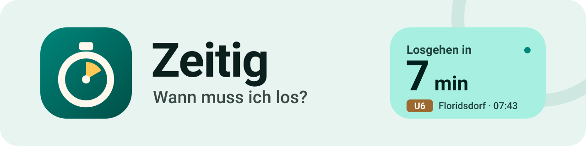
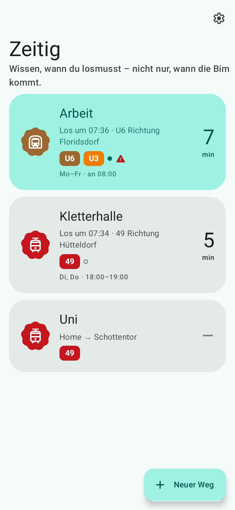
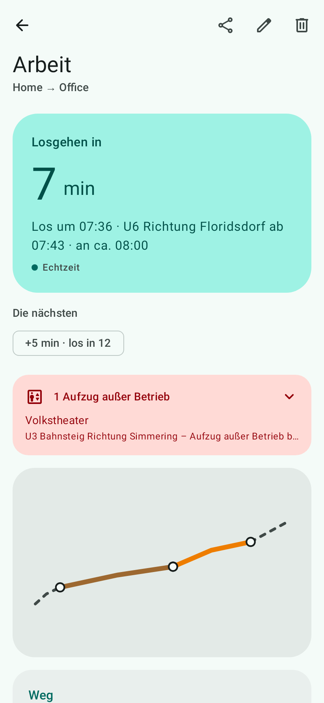
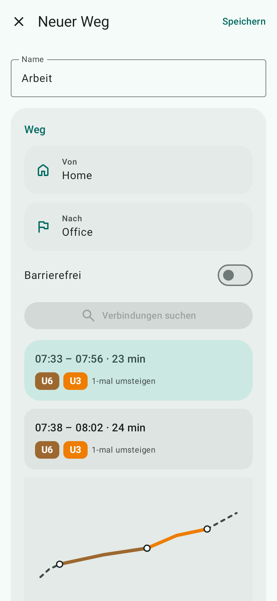
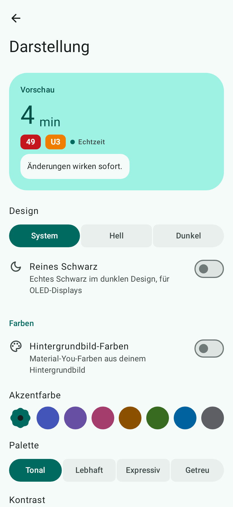
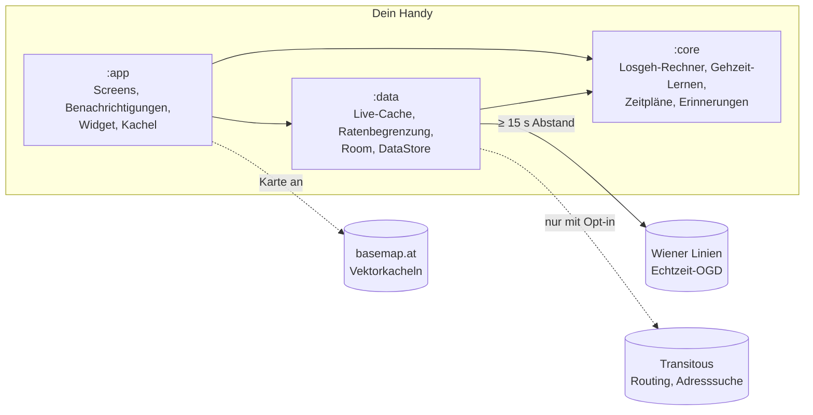

<p align="right"><a href="README.md">English</a> · <b>Deutsch</b></p>

<picture>
  <source media="(prefers-color-scheme: dark)" srcset="docs/images/banner-de-dark.svg">
  
</picture>

**Zeitig sagt dir den Moment, in dem du bei der Tür hinausmusst.** Es verbindet die
Echtzeit-Abfahrten der Wiener Linien mit der Gehzeit, die es aus deinen eigenen Wegen lernt, und
zählt bis zur Sekunde herunter, in der du losgehen musst – in der App, als Benachrichtigung, am
Sperrbildschirm und am Startbildschirm.

[](https://github.com/Brokoli5191/Zeitig/actions/workflows/ci.yml)
[](https://github.com/Brokoli5191/Zeitig/releases)
[](https://github.com/Brokoli5191/Zeitig/releases)
[](LICENSE)
[](app/build.gradle.kts)
[](gradle/libs.versions.toml)

<a href="https://apps.obtainium.imranr.dev/redirect?r=obtainium://app/%7B%22id%22%3A%22app.brokoli5191.zeitig%22%2C%22url%22%3A%22https%3A%2F%2Fgithub.com%2FBrokoli5191%2FZeitig%22%2C%22author%22%3A%22Brokoli5191%22%2C%22name%22%3A%22Zeitig%22%7D"></a>

## Warum

Öffi-Apps beantworten „Wann kommt die Bim?“. An der Wohnungstür brauchst du etwas anderes: „Wann
muss ich gehen?“ Zeitig rechnet

```
losgehen = Abfahrt − Gehzeit − Puffer
```

und trifft die Gehzeit, weil es sie aus deinen echten Wegen lernt, statt zu raten.

## Screenshots

<table>
  <tr>
    <td><picture><source media="(prefers-color-scheme: dark)" srcset="docs/screenshots/home_dark_de.png"></picture></td>
    <td><picture><source media="(prefers-color-scheme: dark)" srcset="docs/screenshots/route_dark_de.png"></picture></td>
    <td><picture><source media="(prefers-color-scheme: dark)" srcset="docs/screenshots/editor_dark_de.png"></picture></td>
    <td><picture><source media="(prefers-color-scheme: dark)" srcset="docs/screenshots/appearance_dark_de.png"></picture></td>
  </tr>
  <tr>
    <td align="center">Deine Wege</td>
    <td align="center">Losgehen in 7 min</td>
    <td align="center">Weg planen</td>
    <td align="center">Farben und Kontrast</td>
  </tr>
</table>

Die Bilder sind die Referenz-Screenshots der UI-Tests und zeigen deshalb immer den aktuellen Code.
Alle Varianten (dunkel, Englisch, hoher Kontrast, reines Schwarz, 200 % Schriftgröße) liegen in
[`docs/screenshots`](docs/screenshots).

## Was Zeitig kann

- **Countdown bis zur Tür.** Echtzeit-Abfahrten der Wiener Linien minus deine Gehzeit minus ein
  Puffer, den du festlegst. Ist eine Abfahrt nicht mehr erreichbar, wechselt Zeitig von selbst zur
  nächsten.
- **Gehzeit, die dazulernt.** Tippe auf „Ich geh los“, geh zur Haltestelle, und Zeitig misst die
  Zeit (sobald du 40 m vor der Haltestelle bist oder auf „Angekommen“ tippst). Es bildet einen
  geglätteten Schnitt deiner letzten 50 Wege und lässt Ausreißer weg – ein Kaffee unterwegs
  verdirbt nichts.
- **Erinnerungen 5, 3 und 1 Minute vorher und „Jetzt losgehen“.** Pro Weg einstellbar. Verpasst du
  die Bim, kommt gleich die nächste Möglichkeit.
- **Wochentage und Zeitfenster.** Mo–Fr 7:20–8:10 oder „Ankunft bis 8:30“ – Zeitig schaut nur
  dann hin, wenn es zählt, und lässt dich dazwischen in Ruhe.
- **Wegplanung mit Karte.** Optional: die schnellste Verbindung mit Umstiegen über
  [Transitous](https://transitous.org), auf einer basemap.at-Karte, auf Wunsch barrierefrei. Ohne
  das wählst du Haltestelle und Linie aus dem mitgelieferten Netz – das Planen klappt dann offline.
- **Direkt aus Google Maps.** Teile eine Route oder einen Ort aus Google Maps (oder Apple Maps,
  OpenStreetMap, jedem `geo:`-Link) an Zeitig: Start und Ziel werden übernommen und die
  Verbindung geplant.
- **Störungen und Aufzüge.** Eine Störung oder ein kaputter Aufzug auf deinen Linien wird einmal
  gemeldet, nicht jeden Morgen aufs Neue.
- **Auch außerhalb der App.** Der Countdown läuft in einer Benachrichtigung (unter Android 16 als
  Live-Update), in einem Widget am Startbildschirm und in einer Schnelleinstellungs-Kachel.
- **Ankunftszeit teilen**, Statistik pro Weg (Pünktlichkeit, typische Gehzeit, Wochentage),
  Deutsch und Englisch, Material 3 Expressive mit Hintergrundfarben, hohem Kontrast und
  reduzierter Bewegung.

## Installation

Ab Android 9. Zeitig gibt es als signierte APK auf
[GitHub Releases](https://github.com/Brokoli5191/Zeitig/releases), nicht im Play Store.

- **[Obtainium](https://github.com/ImranR98/Obtainium)** (empfohlen) installiert die App und hält
  sie aktuell: Badge oben antippen. Release Candidates sind als Vorabversionen markiert; schalte in
  Obtainium „Include prereleases“ ein, wenn du sie willst.
- **Von Hand:** `zeitig-vX.Y.Z.apk` und `SHA256SUMS.txt` aus dem Release laden und vor der
  Installation prüfen:

  ```sh
  sha256sum -c SHA256SUMS.txt
  gh attestation verify zeitig-vX.Y.Z.apk --repo Brokoli5191/Zeitig
  ```

  Die zweite Zeile belegt, dass die APK vom Release-Workflow dieses Repositorys aus dem getaggten
  Commit gebaut wurde (GitHub Artifact Attestation).

## Berechtigungen

| Berechtigung | Wofür |
|---|---|
| Internet, Netzwerkstatus | Abfahrten von den Wiener Linien; Wegplanung und Kartenkacheln nur, wenn du sie einschaltest |
| Standort (ungefähr oder genau) | Nur auf Anfrage: „Einmal meinen Standort verwenden“ im Planer und während einer Gehzeit-Messung, die du gestartet hast. Nie im Hintergrund, nie gespeichert. |
| Benachrichtigungen | Erinnerungen, Live-Countdown, Störungen |
| Live-Updates (`POST_PROMOTED_NOTIFICATIONS`) | Damit Android 16 den Countdown in der Statusleiste und am Sperrbildschirm zeigen darf |
| Vordergrunddienste (Sondernutzung, Standort) | Der Countdown während eines Zeitfensters; die Gehzeit-Messung |
| Wecker und Erinnerungen (`SCHEDULE_EXACT_ALARM`) | Optional: startet den Countdown genau zu Beginn eines Zeitfensters. Ohne fragt eine Benachrichtigung, ob er starten soll. |
| Wach halten (`WAKE_LOCK`) | Nur in den letzten Minuten vor einer Erinnerung, damit sie nicht zu spät kommt |
| Beim Start ausführen | Stellt die Zeitfenster-Wecker nach einem Neustart wieder |
| WLAN-Status | Verlangt die Kartenbibliothek MapLibre; Zeitig liest ihn nicht |

## Datenschutz

Kein Konto, kein eigener Server, keine Analyse, keine Werbung, keine Google Play Services. Zeitig
spricht mit:

- **Wiener Linien** (`wienerlinien.at`) für Abfahrten und Störungen – die Anfragen enthalten
  Haltestellen-IDs und Liniennamen, kein Konto und keine Geräte-ID. Höchstens eine Anfrage alle 15
  Sekunden, wie es die Open-Data-Bedingungen verlangen.
- **Transitous** (`transitous.org`) erst, wenn du die Wegplanung einschaltest: Start und Ziel der
  gesuchten Verbindung oder der Text, den du in die Adresssuche tippst.
- **basemap.at** nur bei eingeschalteter Karte: die Kartenkacheln des Ausschnitts, den du ansiehst.
- **Google** (`maps.app.goo.gl`) nur, wenn du einen Google-Maps-Kurzlink an Zeitig teilst: eine
  Anfrage, die liest, wohin der Link zeigt. Google Maps selbst wird nicht geladen.

Wege, Gehzeiten und Einstellungen bleiben auf deinem Handy. Die Android-eigene Sicherung nimmt sie
mit, wenn du sie verwendest; heruntergeladene Haltestellendaten und Caches bleiben draußen.

## So funktioniert es



- `:core` ist reines Kotlin ohne Android: Losgeh-Rechner, Gehzeit-Modell, Zeitpläne,
  Erinnerungslogik und Haltestellensuche, abgedeckt durch Tests (≥ 90 % Zeilenabdeckung, in der CI
  erzwungen).
- `:data` enthält den Wiener-Linien-Client, eine globale Ratenbegrenzung für jede Anfrage, die
  mitgelieferten Haltestellen- und Liniendaten (monatlich per Workflow aktualisiert), den
  Transitous-Client, Room und DataStore.
- `:app` ist Jetpack Compose mit Material 3 Expressive, ein Vordergrunddienst für den Countdown, ein
  Glance-Widget und eine Schnelleinstellungs-Kachel.

Jede nicht offensichtliche Entscheidung steht samt Alternativen in
[`docs/DECISIONS.md`](docs/DECISIONS.md) (Englisch).

## Bauen

JDK 21 und das Android SDK; alles andere kommt über den Gradle Wrapper.

```sh
./gradlew assembleDebug                      # app/build/outputs/apk/debug/
./gradlew spotlessCheck lint testDebugUnitTest verifyRoborazziDebug :core:koverVerify assembleDebug   # was die CI ausführt
./gradlew recordRoborazziDebug               # Screenshots nach UI-Änderungen neu aufnehmen
```

Was nur ein echtes Handy zeigen kann (Doze, Live-Updates, Widget, Gehzeit-Messung), wird mit
[`docs/DEVICE-CHECKS.md`](docs/DEVICE-CHECKS.md) und `scripts/device-checks.sh` geprüft.

## Releases

Versionen heißen `MAJOR.MINOR.PATCH`, Release Candidates `-rcN`. Der Version Code ist
`MAJOR·1 000 000 + MINOR·10 000 + PATCH·100 + N` (99 für die finale Version), damit sich
`1.2.0-rc1` = 1020001 sauber auf `1.2.0` = 1020099 aktualisieren lässt.

Ein Maintainer startet ein Release unter *Actions › Release › Run workflow* mit der Version. Der
[Release-Workflow](.github/workflows/release.yml) baut und signiert die APK, prüft Signatur und
Version, beglaubigt ihre Herkunft und legt erst dann Tag und GitHub-Release mit Notizen aus den
gemergten Pull Requests an. Der Signaturschlüssel existiert nur als GitHub-Actions-Secret.

Vor dem ersten Release legt ein Maintainer diesen Schlüssel einmalig mit `scripts/setup-signing.ps1`
(Windows) oder `scripts/setup-signing.sh` (Linux, macOS) an. Das Skript erzeugt den Keystore lokal
und setzt die vier Secrets über die GitHub CLI; das Passwort wird nie ausgegeben.

Das Baseline Profile, das den ersten Start beschleunigt, erzeugt bei Bedarf der
[Baseline-Profile-Workflow](.github/workflows/baseline-profile.yml) auf einem Emulator.

## Bekannte Grenzen

- Echtzeitdaten gibt es nur von den Wiener Linien. Teilstrecken mit ÖBB oder Badner Bahn nutzen
  den Fahrplan.
- Abfahrten werden alle 30 Sekunden aktualisiert, solange du hinschaust, sonst nur knapp vor einer
  Erinnerung – die Wiener Linien erlauben eine Anfrage alle 15 Sekunden, und ein Handy in der
  Tasche soll nicht pollen.
- Ohne „Wecker und Erinnerungen“ kann ein Zeitfenster den Countdown nicht selbst starten; eine
  Benachrichtigung bittet um einen Tipp.
- Auf einem Samsung-Handy noch nicht bestätigt: ob der Countdown unter One UI als Live-Update oder
  in der Now Bar erscheint. Siehe [Gerätechecks](docs/DEVICE-CHECKS.md).

## Ideen

- Österreichische Feiertage und eine Urlaubspause für Zeitpläne
- Echtzeit für ÖBB-Teilstrecken, sobald es eine offene Quelle gibt
- Kachel für Wear OS

Ideen und Fehler bitte als [Issue](https://github.com/Brokoli5191/Zeitig/issues/new/choose).

## Mitmachen

Siehe [CONTRIBUTING.md](CONTRIBUTING.md). Sicherheitslücken: [SECURITY.md](SECURITY.md). Es gilt der
[Code of Conduct](CODE_OF_CONDUCT.md).

## Quellen und Lizenzen

- Echtzeit-Abfahrten, Haltestellen und Linien: Wiener Linien. Datenquelle: Stadt Wien –
  [data.wien.gv.at](https://data.wien.gv.at) (CC BY 4.0).
- Wegplanung: [Transitous](https://transitous.org) ([Datenquellen](https://transitous.org/sources/)),
  Kartendaten © [OpenStreetMap](https://www.openstreetmap.org/copyright)-Mitwirkende (ODbL).
- Karte: [basemap.at](https://basemap.at) (CC BY 4.0).
- Icons: [Material Symbols](https://fonts.google.com/icons) (Apache License 2.0).

Zeitig ist ein unabhängiges Projekt und steht in keiner Verbindung zu den Wiener Linien oder der
Stadt Wien.

## Lizenz

[GPL-3.0-or-later](LICENSE)
