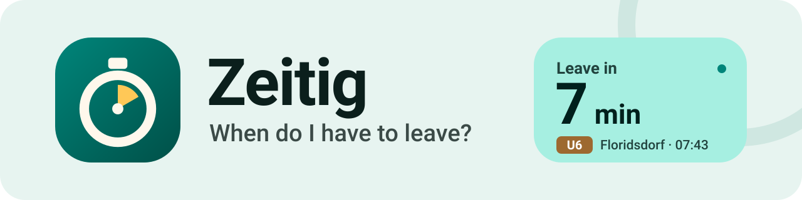
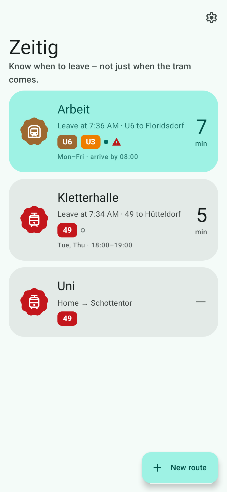
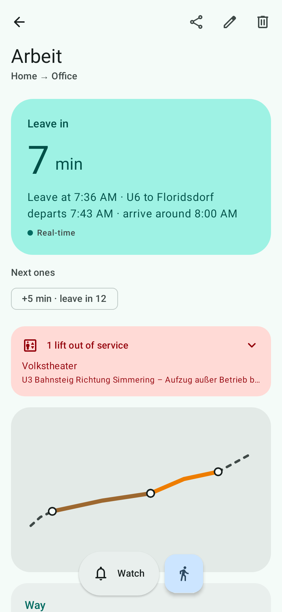
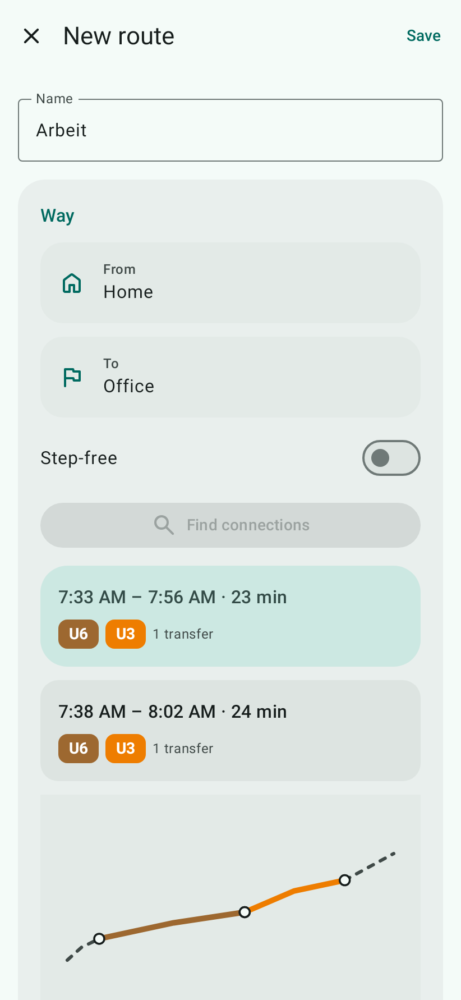
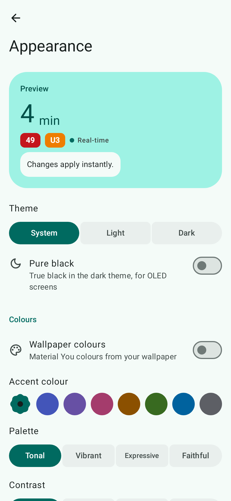
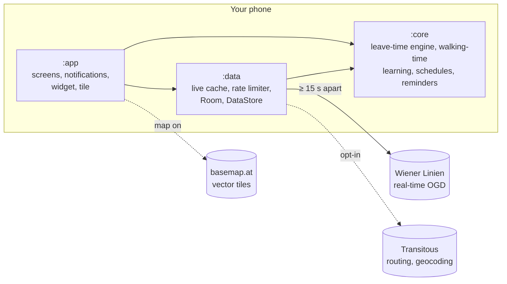

<p align="right"><b>English</b> · <a href="README.de.md">Deutsch</a></p>

<picture>
  <source media="(prefers-color-scheme: dark)" srcset="docs/images/banner-en-dark.svg">
  
</picture>

**Zeitig tells you the moment to walk out the door.** It combines Wiener Linien real-time
departures with the walking time it learns from your own trips, and counts down to the second you
have to leave – in the app, in a notification, on the lock screen and on your home screen.

[](https://github.com/Brokoli5191/Zeitig/actions/workflows/ci.yml)
[](https://github.com/Brokoli5191/Zeitig/releases)
[](https://github.com/Brokoli5191/Zeitig/releases)
[](LICENSE)
[](app/build.gradle.kts)
[](gradle/libs.versions.toml)

<a href="https://apps.obtainium.imranr.dev/redirect?r=obtainium://app/%7B%22id%22%3A%22app.brokoli5191.zeitig%22%2C%22url%22%3A%22https%3A%2F%2Fgithub.com%2FBrokoli5191%2FZeitig%22%2C%22author%22%3A%22Brokoli5191%22%2C%22name%22%3A%22Zeitig%22%7D"></a>

## Why

Transit apps answer "when does the tram come?". At the door you need something else: "when do I
have to go?". Zeitig computes

```
leave at = departure − walking time − buffer
```

and gets the walking time right by learning it from your real trips instead of guessing.

## Screenshots

<table>
  <tr>
    <td><picture><source media="(prefers-color-scheme: dark)" srcset="docs/screenshots/home_dark_en.png"></picture></td>
    <td><picture><source media="(prefers-color-scheme: dark)" srcset="docs/screenshots/route_dark_en.png"></picture></td>
    <td><picture><source media="(prefers-color-scheme: dark)" srcset="docs/screenshots/editor_dark_en.png"></picture></td>
    <td><picture><source media="(prefers-color-scheme: dark)" srcset="docs/screenshots/appearance_dark_en.png"></picture></td>
  </tr>
  <tr>
    <td align="center">Your routes</td>
    <td align="center">Leave in 7 min</td>
    <td align="center">Plan a route</td>
    <td align="center">Colours and contrast</td>
  </tr>
</table>

The images are the reference screenshots of the UI tests, so they always show the current code.
All variants (dark, German, high contrast, pure black, 200 % font size) are in
[`docs/screenshots`](docs/screenshots).

## Features

- **Countdown to the door.** Wiener Linien real-time departures minus your walking time minus a
  buffer you choose. When a departure is out of reach, Zeitig switches to the next one by itself.
- **Walking time that learns.** Tap "I'm leaving", walk to the stop, and Zeitig measures the time
  (within 40 m of the stop, or with one tap on "Arrived"). It keeps a smoothed average of your last
  50 trips and ignores outliers – a coffee on the way does not ruin it.
- **Reminders 5, 3, 1 minutes before and "leave now".** Configurable per route. If you miss the
  tram, the next option follows.
- **Weekdays and time windows.** Mon–Fri 7:20–8:10, or "arrive by 8:30" – Zeitig only watches when
  it matters, and asks nothing in between.
- **Journey planning with a map.** Optional: the fastest connection with transfers via
  [Transitous](https://transitous.org), shown on a basemap.at map, step-free if you want. Without
  it, pick a stop and a line from the bundled network – planning then works offline.
- **Straight from Google Maps.** Share a route or a place from Google Maps (or Apple Maps,
  OpenStreetMap, any `geo:` link) to Zeitig: start and destination are taken over and the
  connection is planned.
- **Disruptions and lifts.** A disruption or a broken lift on your lines is reported once, not
  every morning again.
- **Outside the app, too.** The countdown runs in a notification (a Live Update on Android 16), in
  a home screen widget and in a Quick Settings tile.
- **Share your ETA**, statistics per route (punctuality, typical walk, weekdays), English and
  German, Material 3 Expressive with wallpaper colours, high contrast and reduced motion.

## Install

Android 9 or newer. Zeitig is distributed as a signed APK on
[GitHub Releases](https://github.com/Brokoli5191/Zeitig/releases), not in the Play Store.

- **[Obtainium](https://github.com/ImranR98/Obtainium)** (recommended) installs it and keeps it up
  to date: use the badge above. Release candidates are marked as pre-releases; turn on "Include
  prereleases" in Obtainium if you want them.
- **By hand:** download `zeitig-vX.Y.Z.apk` and `SHA256SUMS.txt` from the release and check them
  before installing:

  ```sh
  sha256sum -c SHA256SUMS.txt
  gh attestation verify zeitig-vX.Y.Z.apk --repo Brokoli5191/Zeitig
  ```

  The second line proves that the APK was built by this repository's release workflow from the
  tagged commit (GitHub artifact attestation).

## Permissions

| Permission | What for |
|---|---|
| Internet, network state | Departures from Wiener Linien; journey planning and map tiles only when you turn them on |
| Location (approximate or precise) | Only on request: "use my location once" in the planner, and while measuring a walk you started. Never in the background, never stored. |
| Notifications | Reminders, the live countdown, disruptions |
| Live Updates (`POST_PROMOTED_NOTIFICATIONS`) | Lets Android 16 show the countdown in the status bar and on the lock screen |
| Foreground services (special use, location) | The countdown during a time window; measuring a walk |
| Alarms & reminders (`SCHEDULE_EXACT_ALARM`) | Optional: starts the countdown exactly when a window begins. Without it, a notification asks you to start it. |
| Keep awake (`WAKE_LOCK`) | Only in the last minutes before a reminder, so it is not late |
| Run at startup | Re-arms the window alarms after a restart |
| Wi-Fi state | Requested by the MapLibre map library; Zeitig does not read it |

## Privacy

No account, no server of its own, no analytics, no ads, no Google Play Services. Zeitig talks to:

- **Wiener Linien** (`wienerlinien.at`) for departures and disruptions – the requests contain stop
  IDs and line names, no account and no device ID. At most one request every 15 seconds, as the
  open-data terms ask.
- **Transitous** (`transitous.org`) only after you turn on journey planning: start and destination
  of the connection you search for, or the text you type into the address search.
- **basemap.at** only with the map turned on: the map tiles of the area you look at.
- **Google** (`maps.app.goo.gl`) only when you share a Google Maps short link into Zeitig: one
  request that reads where the link points. Google Maps itself is not loaded.

Routes, walking times and settings stay on your phone. Android's own backup includes them if you
use it; downloaded stop data and caches are left out.

## How it works



- `:core` is plain Kotlin without Android: the leave-time engine, the walking-time model, schedules,
  reminder logic and the stop search, covered by tests (≥ 90 % line coverage, enforced in CI).
- `:data` holds the Wiener Linien client, one global rate limiter for every request, the bundled
  stop and line data (refreshed monthly by a workflow), the Transitous client, Room and DataStore.
- `:app` is Jetpack Compose with Material 3 Expressive, a foreground service for the countdown, a
  Glance widget and a Quick Settings tile.

Every non-obvious choice is written down with its alternatives in
[`docs/DECISIONS.md`](docs/DECISIONS.md).

## Build

JDK 21 and the Android SDK; everything else comes through the Gradle wrapper.

```sh
./gradlew assembleDebug                      # app/build/outputs/apk/debug/
./gradlew spotlessCheck lint testDebugUnitTest verifyRoborazziDebug :core:koverVerify assembleDebug   # what CI runs
./gradlew recordRoborazziDebug               # re-record the screenshots after UI changes
```

Behaviour that only a real phone can show (Doze, Live Updates, the widget, the walk measurement) is
checked with [`docs/DEVICE-CHECKS.md`](docs/DEVICE-CHECKS.md) and `scripts/device-checks.sh`.

## Releases

Versions are `MAJOR.MINOR.PATCH`, release candidates `-rcN`. The version code is
`MAJOR·1 000 000 + MINOR·10 000 + PATCH·100 + N` (99 for a final release), so `1.2.0-rc1` = 1020001
updates cleanly to `1.2.0` = 1020099.

A maintainer starts a release under *Actions › Release › Run workflow* with the version. The
[release workflow](.github/workflows/release.yml) builds and signs the APK, verifies signature and
version, attests its provenance, and only then creates the tag and the GitHub release with notes
from the merged pull requests. The signing key exists only as GitHub Actions secrets.

Before the first release, a maintainer creates that key once, by hand or with a script:
[`docs/RELEASING.md`](docs/RELEASING.md) has the steps.

The Baseline Profile that speeds up the first start is generated on demand by the
[Baseline profile workflow](.github/workflows/baseline-profile.yml) on an emulator.

## Known limitations

- Real-time data exists only for Wiener Linien. Legs with ÖBB or Badner Bahn use the timetable.
- Departure data is refreshed every 30 seconds while you look at it, otherwise only right before a
  reminder – Wiener Linien allows one request every 15 seconds, and a phone in your pocket should
  not poll.
- Without "Alarms & reminders", a time window cannot start the countdown by itself; a notification
  asks for a tap.
- Not yet confirmed on a Samsung phone: whether the countdown appears as a Live Update or in the
  Now Bar on One UI. See the [device checks](docs/DEVICE-CHECKS.md).

## Ideas

- Austrian public holidays and a holiday pause for schedules
- Real-time data for ÖBB legs, if an open source becomes available
- Wear OS tile

Ideas and bug reports go into the [issues](https://github.com/Brokoli5191/Zeitig/issues/new/choose).

## Contributing

See [CONTRIBUTING.md](CONTRIBUTING.md). Security issues: [SECURITY.md](SECURITY.md). This project
follows the [Code of Conduct](CODE_OF_CONDUCT.md).

## Attribution

- Real-time departures, stops and lines: Wiener Linien. Datenquelle: Stadt Wien –
  [data.wien.gv.at](https://data.wien.gv.at) (CC BY 4.0).
- Journey planning: [Transitous](https://transitous.org) ([data sources](https://transitous.org/sources/)),
  map data © [OpenStreetMap](https://www.openstreetmap.org/copyright) contributors (ODbL).
- Map: [basemap.at](https://basemap.at) (CC BY 4.0).
- Icons: [Material Symbols](https://fonts.google.com/icons) (Apache License 2.0).

Zeitig is an independent project and not affiliated with Wiener Linien or Stadt Wien.

## Licence

[GPL-3.0-or-later](LICENSE)
